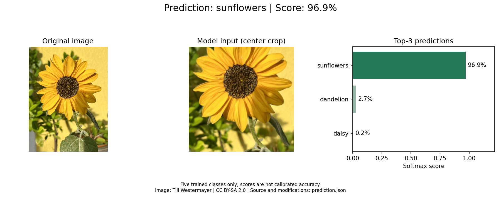
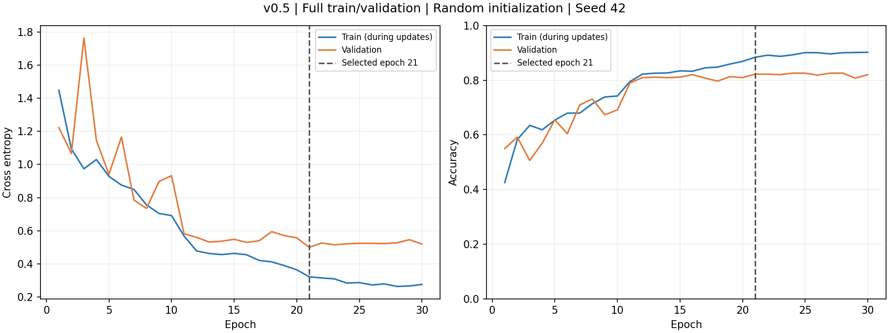
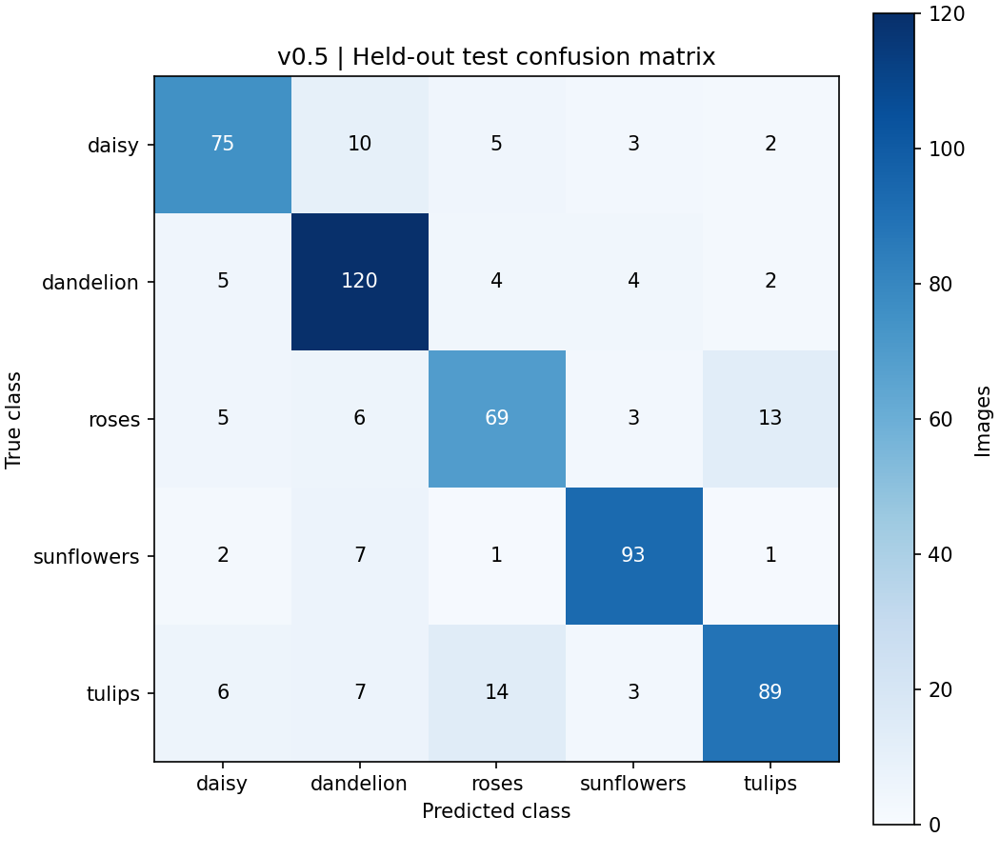

# 花卉图像分类：手写 ResNet-18

这是“后端 AI 方向第一阶段”考核项目。使用 Python、NumPy、Pandas、Matplotlib 和 PyTorch，从数据分析逐步推进到手写 ResNet-18、训练、评估和新图片预测。

当前通过 **v0.6.1：可选整图输入与局限诊断**，并进入 **v1.0 交付准备（尚未最终完成）**。新增 `--view full` 保留图片边缘；同一验证集上准确率从中心裁剪的 82.21% 变为 80.94%，因此默认仍为 center。未知类别识别未可靠解决，简单阈值的实测反例已记录。按用户“无法解决则继续下一版”的要求整理交付材料，真实视频、本人感悟和理解确认仍待完成，不创建最终 v1.0 标签。

交付入口：[项目说明与待填感悟](docs/project-report.md)、[代码阅读指南](docs/code-guide.md)、[运行视频脚本](docs/video-script.md)、[本地包与人工清单](docs/delivery.md)、[交付准备验收](reports/v1.0-preparation/acceptance.md)。代码、文档和报告继续入库；本地交付模型与视频不上传 GitHub。

v0.5 的真实正式结果保持不变：随机初始化训练 30 轮，每轮完整使用 2,564 张训练和 551 张验证图片，按最小验证损失选择第 21 轮；测试 **446/549 正确，准确率 81.24%，macro-F1 0.8087**。这是一组配置、一个种子的实验，不代表外部新图表现；v0.6 未重训或根据新图调参。

## 现在如何运行

本机正式模型与独立环境已准备好。在 Windows PowerShell 运行以下命令，不必激活环境或修改执行策略：

```powershell
Set-Location -LiteralPath 'C:\Users\Cipher\Documents\Codex\2026-10-14\pdf-ai-git-1-pdf-pdf\outputs\flower-resnet18'
& '.\.venv\Scripts\python.exe' scripts\predict.py --image examples\sunflower.jpg
```

成功标志：`PREDICTION PASSED`。本机示例预测为“向日葵”，模型分数约 96.94%，终端显示中文排名和结果路径。默认 CPU、Top-3，每次自动生成新的 `reports/local/predictions/时间戳/`，可重复运行；分数不等于准确率。

查看最近一次结果：

```powershell
$predictionFolder = Get-ChildItem -LiteralPath '.\reports\local\predictions' -Directory | Sort-Object Name -Descending | Select-Object -First 1
Get-Content -LiteralPath (Join-Path $predictionFolder.FullName 'prediction.json') -Encoding utf8
Start-Process -FilePath (Join-Path $predictionFolder.FullName 'prediction.png')
```

自己的图片只需把 `--image` 后的路径换成真实文件路径，路径中有空格时加引号。可选 `--device cuda --top-k 5`，或用 `--checkpoint` 指定另一次正式训练的模型。单图预测不依赖原训练数据或互联网。需要保留整图时添加 `--view full`，成功标志相同；该模式不保证精度更高，见 [v0.6.1 实测与验收](reports/v0.6.1/acceptance.md)。



示例作者 Till Westermayer，作品 Sunflower 2024-10，图像及本演示图采用 **CC BY-SA 2.0**；来源、许可链接和改动见 [示例说明](examples/README.md)。图片在推理前固定，未加入原数据集；单张演示不增加一项准确率成绩。

完整参数、常见错误、新克隆环境到模型再到预测的步骤见 [新图预测说明](docs/inference.md)，实际验证见 [v0.6 验收报告](reports/v0.6/acceptance.md)。旧参考图片重载检查仍可运行：`.venv/Scripts/python.exe scripts/check_checkpoint.py --checkpoint artifacts/v0.5-formal/best.pt --device cpu`，成功标志 `CHECKPOINT CHECK PASSED`。

正式配置、指标含义和模型获取方式见 [正式实验说明](docs/experiments.md)，训练基础见 [v0.4 训练说明](docs/training.md)，网络原理见 [模型与数据说明](docs/model.md)。当前保留 `num_workers=0`，单进程约 14 分钟完成本次正式训练。加载占加载与计算合计耗时约 74.4%，有优化空间，但不妨碍本版验收。Windows 多进程管道失败与 Git HTTPS 崩溃是两件事，均不宣称根因已修复。

如需重新训练，使用新的空目录（已有目录会被拒绝覆盖）：

```powershell
& '.\.venv\Scripts\python.exe' scripts\train.py --config configs\train_formal.json --device cuda --run-dir artifacts\v0.5-rerun --report-dir reports\local\formal-rerun
& '.\.venv\Scripts\python.exe' scripts\check_checkpoint.py --device cpu --checkpoint artifacts\v0.5-rerun\best.pt
```

成功标志为 `FORMAL TRAINING PASSED`、`CHECKPOINT CHECK PASSED`；再次重跑要换未使用的目录名。必须显式指定正式配置，否则默认仍是 smoke。模型约 44.8 MB，保留本机、不入 Git。新克隆仓库须先配置环境并完成下方数据准备，再执行上方正式训练命令生成模型；当前没有模型下载地址。选模固定、绘图及独立测试命令见 [正式实验说明](docs/experiments.md)。不能根据已知测试成绩筛选重跑或调参。

查看本次真实训练日志、指标和图表：

```powershell
Import-Csv -LiteralPath '.\reports\v0.5\formal\metrics.csv' | Format-Table epoch,learning_rate,train_loss,val_loss,val_accuracy
Get-Content -LiteralPath '.\reports\v0.5\test\metrics.json' -Encoding utf8
Start-Process -FilePath '.\reports\v0.5\training_curves.png'
Start-Process -FilePath '.\reports\v0.5\test\confusion_matrix.png'
Start-Process -FilePath '.\reports\v0.5\test\error_examples.png'
```

按最小验证损失保存第 21 轮，验证准确率 82.2142%；测试交叉熵 0.510100、准确率 81.2386%。训练末期验证表现趋于平台，测试错误中发现中心裁剪遗漏边缘花朵和疑似标签噪声，均保留原标签计分，详见 [结果与错误分析](reports/v0.5/analysis.md)。v0.4 的 44% 只是旧试运行子集指标，不能和本次正式测试直接比较。





完整复现数据流程（首次下载约 218 MiB；已有压缩包则直接复用并校验）：

```powershell
& '.\.venv\Scripts\python.exe' scripts\download_data.py
& '.\.venv\Scripts\python.exe' scripts\prepare_data.py
& '.\.venv\Scripts\python.exe' scripts\verify_data.py
& '.\.venv\Scripts\python.exe' -m unittest discover -s tests -v
```

对应成功标志为 `DATA DOWNLOAD VERIFIED`、`DATA PREPARATION PASSED`、`DATA VERIFICATION PASSED` 和 `Ran 47 tests ... OK`。程序失败会返回非零退出码并给出原因。数据验证结果应为 3,664 张、train=2564、val=551、test=549；默认逐张复核原图哈希并检查已知重复没有跨集。离线检查已有包可使用 `download_data.py --offline`。数据准备使用 CPU，不需要启动 GPU 训练。

查看图表和开发历史：

```powershell
Get-Content -LiteralPath '.\reports\v0.2.1\summary.json' -Encoding utf8
Start-Process -FilePath '.\reports\v0.2.1\class_distribution.png'
Start-Process -FilePath '.\reports\v0.2.1\duplicate_pairs_4.jpg'
git log --oneline --decorate
git status --short
git tag --list
```

数据阶段固定证据在 [v0.2.1 验收报告](reports/v0.2.1/analysis.md)，日常重跑图表写入 `reports/local/data-v0.2.1`，可用清单写入 `data/processed-v0.2.1`。旧 `data/processed` 和 `reports/v0.2` 保留；当前模型加载器已绑定修复后的清单和训练集 RGB 统计。不要随意更换种子、图片或复核配置，脚本会拒绝覆盖不同配置的旧划分或报告。复现方式见 [数据说明](docs/data.md)。

可选重新生成扩展候选（不会自动改标签或删除图片）：

```powershell
& '.\.venv\Scripts\python.exe' scripts\audit_data.py --output-dir reports\local\audit-v0.2.1
```

成功标志 `AUDIT MATERIALS READY`；默认阈值 8，覆盖原图、直角旋转、镜像、中心/角落裁剪共 15 种视图，实际生成 45 对候选。候选不是重复结论，逐对判断见 `reports/v0.2.1/review_decisions.csv`。全量联系表只表示已生成材料，不代表全部标签已经审查。

v0.1 的环境检查仍可运行：`.\.venv\Scripts\python.exe scripts\check_env.py --device cuda`，成功标志 `ENV CHECK PASSED`；旧报告继续保存在 `reports/v0.1/`。

v0.3 的随机权重结构检查仍可运行：`.\.venv\Scripts\python.exe scripts\check_model.py --device cuda`，成功标志 `MODEL CHECK PASSED`；它不加载训练模型，不应与当前 checkpoint 检查混淆。

## 本版实际数据结果

| 类别 | 原始 | 保留 | 训练 | 验证 | 测试 |
| --- | ---: | ---: | ---: | ---: | ---: |
| daisy（雏菊） | 633 | 633 | 443 | 95 | 95 |
| dandelion（蒲公英） | 898 | 898 | 628 | 135 | 135 |
| roses（玫瑰） | 641 | 639 | 447 | 96 | 96 |
| sunflowers（向日葵） | 699 | 697 | 488 | 105 | 104 |
| tulips（郁金香） | 799 | 797 | 558 | 120 | 119 |
| 合计 | 3670 | 3664 | 2564 | 551 | 549 |

全部图片解码成功。排除的 6 张分别是跨类相同图片 2 张、同类重复副本 2 张、视觉复核发现的明显标签噪声 2 张；原始文件和标签均保留。近似图片只做整组划分，不仅凭感知哈希删除。已知重复关系没有跨子集，不代表所有潜在近重复或错标都已找全。

v0.2.1 重建使 1,678 张图片的 split 字段改变（含新增排除的 1 张），明细在 `reports/v0.2.1/split_changes.csv`。这是分组/保留集合变化后重新运行整组划分的结果；当时尚未训练模型，也未根据测试成绩选择划分。v0.2 的旧划分不可与新划分混用，旧版 3,665 张统计不是当前结果。v0.3–v0.5 未重新划分数据；v0.4 在原 train/val 内抽样试运行，v0.5 使用完整子集。


## 环境与依赖

- Python 3.12，独立环境目录 `.venv`，不继承系统包。
- PyTorch 2.8.0+cu128、torchvision 0.23.0+cu128；RTX 50 系列选 CUDA 12.8 构建。
- NumPy 2.2.6、Pandas 2.2.3、Matplotlib 3.10.3、Pillow 11.2.1。
- `torchvision` 仅用于图片变换等基础功能；残差块和 ResNet 已手写，不调用现成完整模型或下载预训练权重。
- 只安装 GPU 驱动和这些 Python 包即可使用本项目；这里没有编译 CUDA 扩展，不需要另装完整 CUDA Toolkit。

本机已配置的环境可直接运行。系统默认 `python` 是 3.14，**不要用它替代命令中的 `.venv` 解释器**。本次借助已有的 Python 3.12.14 运行时建立 venv，记录见 `docs/environment.md`。

在另一台 Windows 机器上重建时，先安装官方 Python 3.12 和满足 CUDA 12.8 要求的 NVIDIA 驱动，然后在项目目录运行：

```powershell
py -3.12 -m venv .venv
& '.\.venv\Scripts\python.exe' -m pip install --index-url https://pypi.org/simple -r requirements.txt
& '.\.venv\Scripts\python.exe' -m pip install -r requirements-cu128.txt
& '.\.venv\Scripts\python.exe' -m pip check
& '.\.venv\Scripts\python.exe' scripts\check_env.py --device cuda
```

两份安装清单应**分两条命令**执行：PyTorch 专用源并不提供全部数据分析包。`requirements-lock.txt` 记录本次实际安装的 25 项包版本（pip 安装器单独记在文件头）；需要精确复现时使用：

```powershell
& '.\.venv\Scripts\python.exe' -m pip install --index-url https://pypi.org/simple --extra-index-url https://download.pytorch.org/whl/cu128 -r requirements-lock.txt
```

锁定文件对应本次 Windows / Python 3.12 / CUDA 12.8 环境，不承诺其他平台直接适用。只有 CPU 的机器可安装匹配的 CPU 版 torch/torchvision 并用 `--device cpu` 检查，但那是另一套环境，需重新记录依赖与验证结果。当前未验证其他机器、Linux 或 CPU 专用安装包。

## 项目目录

```text
flower-resnet18/
├── README.md                    # 当前入口与完整运行命令
├── CHANGELOG.md                 # 每版实际改动、验证及问题
├── requirements.txt            # 固定主要分析依赖
├── requirements-cu128.txt      # 匹配本机 GPU 的 PyTorch 包
├── requirements-lock.txt       # 实际环境的完整依赖快照
├── scripts/check_env.py        # v0.1 环境检查，仍可运行
├── scripts/download_data.py    # 官方下载、校验与安全解压
├── scripts/prepare_data.py     # 数据检查、划分和图表入口
├── scripts/data_utils.py       # 图片检查、许可解析、重复分组与划分
├── scripts/verify_data.py      # 独立读取清单并检查实际原图与泄漏
├── scripts/audit_data.py       # 扩展变换候选、全量联系表；不自动删图
├── scripts/check_model.py      # v0.3 CPU/CUDA 实际批次与逐层形状检查
├── scripts/train.py            # smoke/formal 训练、验证选模与保存入口
├── scripts/check_checkpoint.py # 独立进程恢复模型、预处理和映射并核对预测
├── scripts/predict.py          # v0.6 单张新图命令、中文 Top-K、JSON 与展示图
├── scripts/freeze_model.py     # 测试前固定模型与验证选模依据
├── scripts/evaluate.py         # 完整测试、逐图预测、混淆矩阵与错误示例
├── scripts/plot_training.py    # 真实日志生成训练曲线
├── configs/                   # 数据配置、视觉复核、smoke/formal 训练配置
├── tests/                     # 47 项数据、模型、训练、指标及新图行为检查
├── src/model.py                # 手写 BasicBlock 和 ResNet18
├── src/data.py                 # Dataset、预处理、随机种子和 DataLoader
├── src/engine.py               # 训练/验证一轮、损失和参数更新
├── src/checkpoint.py           # 原子保存、严格重载及参考样本预测核对
├── src/evaluation.py           # NumPy 分类指标、选模与报告核验
├── src/inference.py            # 图片解码、正式模型加载、使用保存的参数推理
├── examples/                   # 外部演示缩图及 CC BY-SA 2.0 署名/来源
├── data/                       # downloads/raw/processed-v0.2.1；旧 processed 保留
├── artifacts/                  # 本机 v0.4-smoke/v0.5-formal 模型；大文件不入库
├── reports/v0.1/               # 保留环境阶段证据
├── reports/v0.2/               # 真实统计、图表、清单快照和验证日志
├── reports/v0.2.1/             # 修复后的统计、候选结论、逐图署名和真实日志
├── reports/v0.3/               # CPU/CUDA 前向、28 项检查及实际问题记录
├── reports/v0.4/               # 试运行配置、逐轮日志、保存/重载及32项检查
├── reports/v0.5/               # 正式方案、训练/测试、曲线、错误分析与验收
├── reports/v0.6/               # CPU/CUDA 新图结果、命令行边界与验收证据
├── reports/local/              # 日常检查产物，不入库
├── docs/requirements.md        # PDF 要求对照、版本规划和验收状态
├── docs/environment.md         # 硬件、环境选择和问题处理记录
├── docs/data.md                # 数据流程、字段、复现与边界说明
├── docs/model.md               # 残差连接、形状、预处理和迁移学习原理
├── docs/training.md            # 训练/验证/保存原理、运行方式及试运行边界
├── docs/experiments.md         # 正式训练、选模、评估指标和复现步骤
├── docs/inference.md           # 新图预测、结果查看、模型获取与错误提示
├── docs/data-license.txt       # 原始许可证及全部摄影者署名
└── .venv/                      # 独立环境，不入库
```

## 题目与逐步开发

题目为五类花卉图片分类，数据来源为 TensorFlow 示例花卉集，详见 `data/README.md`。官方包已校验，图片许可为 CC BY 2.0，完整署名见 `docs/data-license.txt`；报告图片另有 `image_attributions.csv` 将图中编号映射到作者、原始来源、许可及缩放说明。源码、统计报告和许可说明入库，原图与压缩包不入库。

版本保持为：v0.1 环境 → v0.2 数据 → v0.2.1 数据修复 → v0.3 手写模型 → v0.4 训练试运行 → v0.5 正式训练评估 → v0.6 新图预测 → v0.6.1 整图可选输入与诊断 → **v1.0 交付准备**。补丁根据实际问题形成，范围保持不变。PDF 要求的迁移学习原理已说明（未训练迁移学习模型），运行视频脚本已准备，真实视频仍待本人录制。详细目标见 `docs/requirements.md`。

## Git 与远程仓库

远程仓库：[shenxiannanzhifu/flower-resnet18](https://github.com/shenxiannanzhifu/flower-resnet18)。2026-10-14 按用户授权首次推送 `main` 分支与 `v0.1` 标签，保留两笔原始开发提交。`origin` 指向该仓库，本地 `main` 已跟踪 `origin/main`。

沿用已有 Git 身份配置；不伪造姓名、邮箱或提交时间。`.gitignore` 排除环境、图片包、模型、视频和常见密钥文件。已完成阶段用标签定位，需要修复时新增提交或补丁标签，不移动已发布标签、不重写历史。

PDF 要求持续提交，首次同步已经完成；之后在各阶段验收后持续保存真实开发历史并同步远程。v0.1 同步后的说明更新作为独立文档提交保留，`v0.1` 仍指向通过环境验收的 `5b959db`，没有移动标签。v0.2 在同仓库的 `feat/data-preparation` 分支逐步提交下载、数据处理、实际问题修复及验收材料，再快进合入 `main`；可用 `git log v0.1..v0.2 --oneline` 查看新增历史。仓库可见范围沿用用户在 GitHub 的设置，未修改；向考核接收人交付仍由用户决定。

已配置的 `main` 是主分支。后续需要独立开发分支时在本仓库创建并保留正常合并历史，不复制项目目录。可用 `git branch --show-current` 查看当前分支。

2026-10-15 在原有 `fix/data-quality-review` 分支接续未提交的审计脚本，分次提交候选工具/分组修复、视觉发现的标签噪声修复及验收材料，随后快进合入 `main`。**v0.2.1 已实际同步 GitHub**：20:51（北京时间）通过隔离的 Python Git 传输工具上传原有四笔提交及标签，重新读取远端确认 main 为 `d7aad41`，`v0.2.1` 仍指向验收提交 `1fc0d87`，旧标签没有移动。此次同步状态说明另作新提交。证明见 `reports/v0.2.1/github-sync.json`；可用 `git log v0.2..main --oneline` 查看正常开发历史。

系统 `git-remote-https.exe` 曾在推送时崩溃，本次绕过该进程完成真实 Git 对象传输，没有重新创建提交、强制推送、禁用证书校验或改变项目依赖。系统 Git 崩溃根因仍未定位，不宣称常规 `git push` 已修复。详情见 [推送故障与恢复记录](docs/git-push-troubleshooting.md)。

**v0.3 已实际同步 GitHub**：2026-10-15 21:46（北京时间），读回远端确认 main=`78b59ea`、v0.3 解引用=`78b59ea`，v0.1/v0.2/v0.2.1 标签不变。三笔实际开发提交为 `21a2086`（手写模型）、`d98c603`（数据接入与真实批次检查）、`78b59ea`（验收文档）。证据见 [GitHub 同步记录](reports/v0.3/github-sync.json)。本段同步说明另作后续文档提交；v0.3 验收标签不移动。可用 `git log a705af9..main --oneline` 查看本阶段历史。

v0.4 的三笔开发提交 `e36fdde`（训练/保存基础）、`8767b01`（真实试运行与重载）、`29d63c0`（验收文档）已于 2026-10-15 23:23（北京时间）实际同步 GitHub。读回确认 main 和 v0.4 标签解引用均为 `29d63c0`，旧标签均未移动；证据见 [v0.4 同步记录](reports/v0.4/github-sync.json)。本段同步说明另作后续文档提交，v0.4 标签保持固定。用 `git log ae96b65..main --oneline` 查看本阶段历史。

v0.5 在同仓库 `feat/formal-evaluation` 分支按真实顺序开发：`7034fa0` 固定方案并支持完整训练，`4aa446f` 实现评估工具，`98b4018` 保存训练结果并在测试前固定模型。后续测试结果、换行兼容修复和验收作为新提交，保留原选择记录。可用 `git log v0.4..main --oneline` 查看完整历史。

**v0.5 已实际同步 GitHub**：2026-10-16 00:20（北京时间）读回确认 main 与 v0.5 解引用均为验收提交 `f607d84`，全部旧标签不变，见 [同步证据](reports/v0.5/github-sync.json)。首次传输遇到网络写入超时，确认远端未变后调长超时重试成功。本段同步说明另作后续提交；v0.5 标签固定，不移动。

**v0.6 已实际同步 GitHub**：2026-10-16 08:32（北京时间）读回确认 main 与 v0.6 解引用均为验收提交 `1466b7d`，全部旧标签不变，见 [同步证据](reports/v0.6/github-sync.json)。本版两笔开发提交为 `6ce002f`（新图推理、检查及固定示例）和 `1466b7d`（实际验证与验收文档），在原仓库快进合入 main。本段同步说明另作后续提交，v0.6 标签保持固定。

## 本阶段建议理解的三个知识点

**v0.6.1 与 v1.0 交付准备已同步 GitHub**：2026-10-16 09:25（北京时间）读回 main=0f0722c，v0.6.1 解引用=500df3b，旧标签保持。证据见 [本轮同步记录](reports/v1.0-preparation/github-sync.json)。本同步说明另作后续提交，不移动验收标签。最终 v1.0 仍等待本人材料，不提前打标签。

1. **权重与预处理要配套**：类别编号、RGB 归一化、缩放和裁剪都从 checkpoint 恢复，不能换一份当前配置猜测。
2. **推理状态的两个开关**：`eval()` 固定 BatchNorm，`inference_mode()` 关闭梯度；两者都要用，见 `src/inference.py`。
3. **预测分数与准确率不同**：softmax 高分也可能错；这个模型只支持五类，其他花种或非花卉也会被分入其中一类，见 `docs/inference.md`。

个人感悟请在 docs/project-report.md 按真实经历填写；视频脚本在 docs/video-script.md，实际视频仍待本人录制。交付准备结束后暂停，由本人查看材料、练习和补齐必要输入，再进行最终验收；不会自动发送成果。
