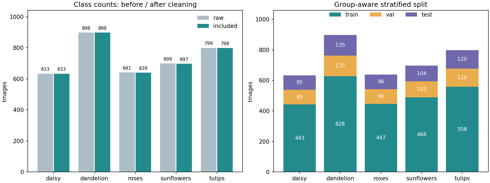

# 花卉图像分类：手写 ResNet-18

这是“后端 AI 方向第一阶段”考核项目。使用 Python、NumPy、Pandas、Matplotlib 和 PyTorch，从数据分析逐步推进到手写 ResNet-18、训练、评估和新图片预测。

当前完成 **v0.2：数据准备与分析**。已下载并核查 3,670 张花卉图片，保留 3,665 张用于训练/验证/测试，完成真实统计与图表。尚未编写 ResNet 或训练模型。每个阶段通过验收后提交并打标签，等待确认后再进入下一版本。所有版本沿用本目录和同一 Git 仓库。

## 现在如何运行

本机数据与独立环境已准备好。在 Windows PowerShell 中运行以下命令即可复核，不必激活环境或修改执行策略：

```powershell
Set-Location -LiteralPath 'C:\Users\Cipher\Documents\Codex\2026-10-14\pdf-ai-git-1-pdf-pdf\outputs\flower-resnet18'
& '.\.venv\Scripts\python.exe' scripts\verify_data.py
```

成功标志：`DATA VERIFICATION PASSED`，JSON 中 `included_images` 为 3665，划分为 train=2564、val=551、test=550。验证会逐张核对原图 SHA-256，并独立检查已识别的重复关系没有跨子集。

完整复现数据流程（首次下载约 218 MiB；已有压缩包则直接复用并校验）：

```powershell
& '.\.venv\Scripts\python.exe' scripts\download_data.py
& '.\.venv\Scripts\python.exe' scripts\prepare_data.py
& '.\.venv\Scripts\python.exe' scripts\verify_data.py
& '.\.venv\Scripts\python.exe' -m unittest discover -s tests -v
```

对应成功标志为 `DATA DOWNLOAD VERIFIED`、`DATA PREPARATION PASSED`、`DATA VERIFICATION PASSED` 和 `Ran 11 tests ... OK`。程序失败会返回非零退出码并给出原因。离线检查已有数据包可使用 `download_data.py --offline`。数据准备使用 CPU，不需要启动 GPU 训练。

查看图表和开发历史：

```powershell
Get-Content -LiteralPath '.\reports\v0.2\summary.json' -Encoding utf8
Start-Process -FilePath '.\reports\v0.2\class_distribution.png'
Start-Process -FilePath '.\reports\v0.2\samples.jpg'
git log --oneline --decorate
git status --short
git tag --list
```

v0.2 的固定证据在 [reports/v0.2](reports/v0.2/analysis.md)，日常重跑图表写入 `reports/local/data`，可用清单写入 `data/processed`。请不要覆盖已提交的版本证据；不要随意更换种子、图片或复核配置，脚本会拒绝覆盖不同配置的旧划分。复现实验的检查方式见 [数据说明](docs/data.md)。

v0.1 的环境检查仍可运行：`.\.venv\Scripts\python.exe scripts\check_env.py --device cuda`，成功标志 `ENV CHECK PASSED`；旧报告继续保存在 `reports/v0.1/`。

## 本版实际数据结果

| 类别 | 原始 | 保留 | 训练 | 验证 | 测试 |
| --- | ---: | ---: | ---: | ---: | ---: |
| daisy（雏菊） | 633 | 633 | 443 | 95 | 95 |
| dandelion（蒲公英） | 898 | 898 | 628 | 135 | 135 |
| roses（玫瑰） | 641 | 639 | 447 | 96 | 96 |
| sunflowers（向日葵） | 699 | 697 | 488 | 105 | 104 |
| tulips（郁金香） | 799 | 798 | 558 | 120 | 120 |
| 合计 | 3670 | 3665 | 2564 | 551 | 550 |

全部图片解码成功。排除的 5 张分别是跨类相同图片 2 张、同类重复副本 2 张、视觉复核发现的明显标签噪声 1 张；原始文件均保留。近似图片只做整组划分，不仅凭感知哈希删除。已知重复关系没有跨子集，不代表所有潜在近重复或错标都已找全。



## 环境与依赖

- Python 3.12，独立环境目录 `.venv`，不继承系统包。
- PyTorch 2.8.0+cu128、torchvision 0.23.0+cu128；RTX 50 系列选 CUDA 12.8 构建。
- NumPy 2.2.6、Pandas 2.2.3、Matplotlib 3.10.3、Pillow 11.2.1。
- `torchvision` 后续仅用于图片变换等基础功能；手写残差块和 ResNet，不调用现成完整模型或下载预训练权重。
- 只安装 GPU 驱动和这些 Python 包即可使用本项目；这里没有编译 CUDA 扩展，不需要另装完整 CUDA Toolkit。

本机已配置的环境可直接运行。系统默认 `python` 是 3.14，**不要用它替代命令中的 `.venv` 解释器**。本次借助已有的 Python 3.12.14 运行时建立 venv，记录见 `docs/environment.md`。

在另一台 Windows 机器上重建时，先安装官方 Python 3.12 和满足 CUDA 12.8 要求的 NVIDIA 驱动，然后在项目目录运行：

```powershell
py -3.12 -m venv .venv
& '.\.venv\Scripts\python.exe' -m pip install --index-url https://pypi.org/simple -r requirements.txt
& '.\.venv\Scripts\python.exe' -m pip install -r requirements-cu128.txt
& '.\.venv\Scripts\python.exe' -m pip check
& '.\.venv\Scripts\python.exe' scripts\check_env.py --device cuda
```

两份安装清单应**分两条命令**执行：PyTorch 专用源并不提供全部数据分析包。`requirements-lock.txt` 记录本次实际安装的 25 项包版本（pip 安装器单独记在文件头）；需要精确复现时使用：

```powershell
& '.\.venv\Scripts\python.exe' -m pip install --index-url https://pypi.org/simple --extra-index-url https://download.pytorch.org/whl/cu128 -r requirements-lock.txt
```

锁定文件对应本次 Windows / Python 3.12 / CUDA 12.8 环境，不承诺其他平台直接适用。只有 CPU 的机器可安装匹配的 CPU 版 torch/torchvision 并用 `--device cpu` 检查，但那是另一套环境，需重新记录依赖与验证结果。当前未验证其他机器、Linux 或 CPU 专用安装包。

## 项目目录

```text
flower-resnet18/
├── README.md                    # 当前入口与完整运行命令
├── CHANGELOG.md                 # 每版实际改动、验证及问题
├── requirements.txt            # 固定主要分析依赖
├── requirements-cu128.txt      # 匹配本机 GPU 的 PyTorch 包
├── requirements-lock.txt       # 实际环境的完整依赖快照
├── scripts/check_env.py        # v0.1 环境检查，仍可运行
├── scripts/download_data.py    # 官方下载、校验与安全解压
├── scripts/prepare_data.py     # 数据检查、划分和图表入口
├── scripts/data_utils.py       # 图片检查、许可解析、重复分组与划分
├── scripts/verify_data.py      # 独立读取清单并检查实际原图与泄漏
├── configs/                   # 可追溯的视觉复核关系与排除理由
├── tests/                     # 11 个数据质量与防泄漏回归测试
├── src/                        # v0.3 起逐步编写模型和训练代码
├── data/                       # downloads/raw/processed；原图和本地处理产物不入库
├── artifacts/                  # 后续模型文件；大文件不入库
├── reports/v0.1/               # 保留环境阶段证据
├── reports/v0.2/               # 真实统计、图表、清单快照和验证日志
├── reports/local/              # 日常检查产物，不入库
├── docs/requirements.md        # PDF 要求对照、版本规划和验收状态
├── docs/environment.md         # 硬件、环境选择和问题处理记录
├── docs/data.md                # 数据流程、字段、复现与边界说明
├── docs/data-license.txt       # 原始许可证及全部摄影者署名
└── .venv/                      # 独立环境，不入库
```

## 题目与逐步开发

题目为五类花卉图片分类，数据来源为 TensorFlow 示例花卉集，详见 `data/README.md`。官方包已校验，图片许可为 CC BY 2.0，完整署名见 `docs/data-license.txt`；报告图片另有 `image_attributions.csv` 将图中编号映射到作者、原始来源、许可及缩放说明。源码、统计报告和许可说明入库，原图与压缩包不入库。

版本保持为：v0.1 环境 → v0.2 数据 → v0.3 手写模型 → v0.4 训练试运行 → v0.5 正式训练评估 → v0.6 新图预测 → v1.0 验收材料。详细目标见 `docs/requirements.md`。试运行成绩与正式实验分开；没有真实证据就不标记完成。

## Git 与远程仓库

远程仓库：[shenxiannanzhifu/flower-resnet18](https://github.com/shenxiannanzhifu/flower-resnet18)。2026-10-14 按用户授权首次推送 `main` 分支与 `v0.1` 标签，保留两笔原始开发提交。`origin` 指向该仓库，本地 `main` 已跟踪 `origin/main`。

沿用已有 Git 身份配置；不伪造姓名、邮箱或提交时间。`.gitignore` 排除环境、图片包、模型、视频和常见密钥文件。已完成阶段用标签定位，需要修复时新增提交或补丁标签，不移动已发布标签、不重写历史。

PDF 要求持续提交，首次同步已经完成；之后在各阶段验收后持续保存真实开发历史并同步远程。v0.1 同步后的说明更新作为独立文档提交保留，`v0.1` 仍指向通过环境验收的 `5b959db`，没有移动标签。v0.2 在同仓库的 `feat/data-preparation` 分支逐步提交下载、数据处理、实际问题修复及验收材料，再快进合入 `main`；可用 `git log v0.1..v0.2 --oneline` 查看新增历史。仓库可见范围沿用用户在 GitHub 的设置，未修改；向考核接收人交付仍由用户决定。

已配置的 `main` 是主分支。后续需要独立开发分支时在本仓库创建并保留正常合并历史，不复制项目目录。可用 `git branch --show-current` 查看当前分支。

## 本阶段建议理解的三个知识点

1. **先分组再划分**：把同图副本随机放入训练和测试集会让评估过于乐观。重复关系必须作为整体分配；感知哈希只能提供候选，视觉核查可补充漏检。
2. **数据清单与可复现性**：CSV 记录原图路径、类别、哈希、排除理由和子集；固定随机种子还不够，图片内容、排序、复核配置也必须固定。
3. **统计量也要防泄漏**：Pandas 负责表格和分组统计；NumPy 实际计算图像尺寸分位数、感知哈希与训练集 RGB 均值/标准差。训练统计只来自训练集，Matplotlib 图表来自真实数据而非示例数字。

个人感悟将在最终说明中由你根据真实学习经历填写；不会代写虚构经历。视频目前未录制，演示脚本在 v1.0 整理。当前版本结束后等待“继续下一个版本”。
