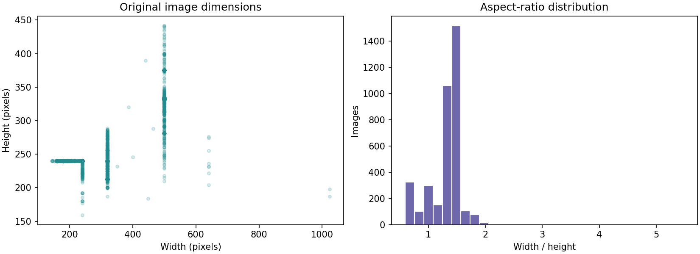
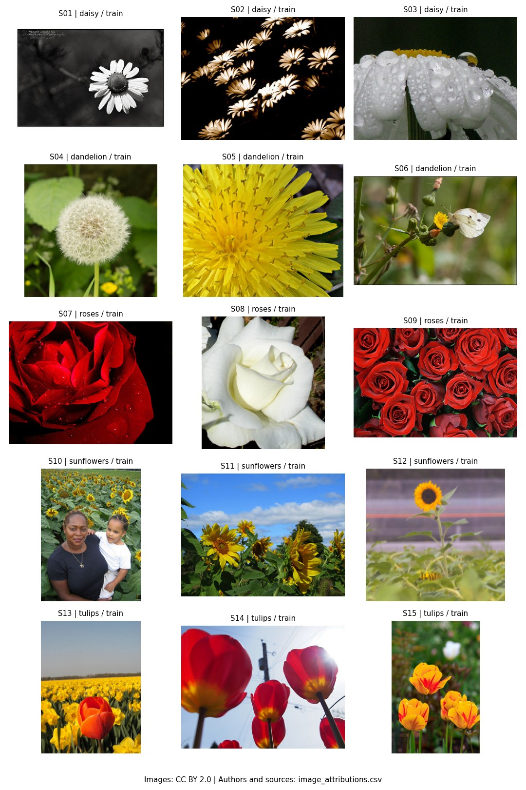
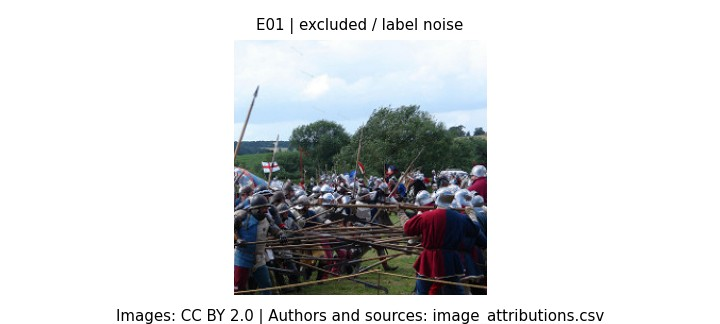

# v0.2 数据分析与验收结果

这是数据分析结果，不是模型训练指标。来源：官方 TensorFlow flower_photos，2026-10-14 实际运行；原始记录见 source.json、summary.json、manifest.csv 和运行日志。

## 真实数据结论

- 官方压缩包大小 228,813,984 字节，SHA-256 与 TensorFlow Datasets 的独立官方清单一致；3,671 个解压文件逐一核对通过。
- 3,670 张图均能解码，均为 RGB；许可署名 3,670/3,670 完整对应。
- 排除跨类别相同图片 2 张、同类相同像素的额外副本 2 张、明显非花卉的标签噪声 1 张；原图不删除，保留 3,665 张。
- 训练/验证/测试为 2,564 / 551 / 550，每类均有样本，满足按组分层后的整数目标；已识别的重复关系跨集数量为 0。
- 清洗后最大/最小类数量比约 1.419，存在适度不均衡；目前不额外做过采样。后续训练是否调整，应由真实问题和验证结果决定。

| 类别 | 原始 | 排除 | 训练 | 验证 | 测试 |
| --- | ---: | ---: | ---: | ---: | ---: |
| daisy | 633 | 0 | 443 | 95 | 95 |
| dandelion | 898 | 0 | 628 | 135 | 135 |
| roses | 641 | 2 | 447 | 96 | 96 |
| sunflowers | 699 | 2 | 488 | 105 | 104 |
| tulips | 799 | 1 | 558 | 120 | 120 |

图片宽度范围 143–1024、高度范围 159–442；宽度中位数 320，高度中位数 240；宽高比约 0.596–5.476。尺寸差异说明后续必须统一输入尺寸，同时注意极宽图片的裁剪/拉伸影响。这是 v0.3 的实现建议，尚未实施模型预处理。

训练集原图像素加权 RGB 均值约 `[0.467005, 0.424954, 0.308067]`，标准差约 `[0.300913, 0.272545, 0.297506]`；使用 269,331,402 个训练像素，范围为 0–1，未从验证集或测试集估计这些统计量。

## 样本与质量问题

样本由固定种子从训练子集选取，展示不同拍摄角度、花朵尺度、背景和图像编辑风格。图片的 S/P/E 编号对应 [逐图署名](image_attributions.csv)，包括作者、来源、CC BY 2.0 许可链接和缩略图说明；完整原始署名在 ../../docs/data-license.txt。

重复核查图为 duplicate_pairs_1.jpg 至 duplicate_pairs_4.jpg，覆盖 30 条自动候选和 1 条额外视觉关系。候选关系是保守合组依据，不全是可证明相同的图片；只有确认的完全相同像素副本被去重。视觉复核补充了 pHash 距离 18 的向日葵场景，修复初步划分中已知的 train/test 泄漏。

该图原来位于 roses 类别。它保留在原始目录，未改标签；清单中标记为 excluded。初查 3,666 张的结果随该问题修复更新为 3,665 张，最终指标以本目录当前清单为准。

## 验收证据

| 检查 | 实际结果 | 文件 |
| --- | --- | --- |
| 官方下载、安全解压与逐文件校验 | 成功；离线复用也成功 | download.log、offline-download-check.log、source.json |
| 真实图片分析与最终划分 | DATA PREPARATION PASSED | prepare.log、summary.json、manifest.csv |
| 独立读取清单核对原图、子集和重复关系 | DATA VERIFICATION PASSED | verification.json、verify.log |
| 从原图重跑完整流程 | 7 个核心文件逐字节相同 | reproduce.log、reproducibility.json |
| 真实故障边界回归 | 11 tests，OK | tests.log |
| 图表视觉核对 | 类别/尺寸/样本/全部候选及排除示例已查看 | PNG/JPG 文件及逐图署名 |

初次最终准备命令：`scripts/prepare_data.py --report-dir reports/v0.2`；复现命令：`scripts/prepare_data.py --output-dir data/processed-recheck --report-dir reports/v0.2`。二者均使用项目 `.venv/Scripts/python.exe`。对应生产清单和复现清单相同，报告只在验收过程中生成，日常请使用默认的 reports/local/data。

最终主清单 SHA-256：`1ecbac0b600441c608fa99b40eb7035a3f6af0dc021e66205ef5d4e2f2cca1c3`。

尚未验证或实现：全部图片逐张语义复核、所有潜在近重复、PyTorch 数据加载、手写 ResNet、训练/保存/预测和正式实验。v0.3 将使用已经固定的清单，不开始训练或宣称模型已训练好。
